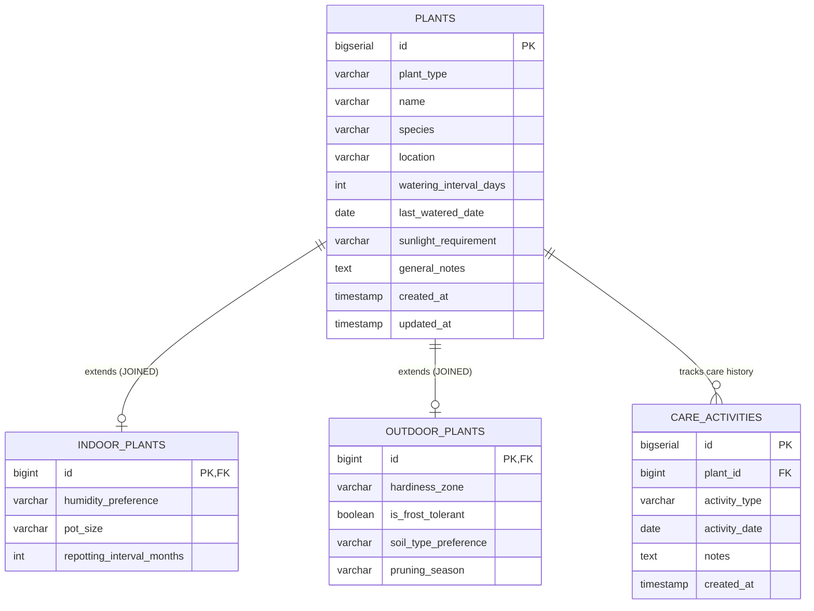

# System Architecture: Virtual Plant Care Management System

## 1. High-Level Architecture Overview

The **Virtual Plant Care Management System** follows a decoupled multi-tier architecture:

```
[ Client Browser (React + Vite) ]
             │  (HTTP / JSON REST APIs on port 5173 -> 8080)
             ▼
[ Java 21 Spring Boot Backend ]
  ├── Presentation: Controllers (@RestController)
  ├── Business Logic: Services (@Service)
  ├── Data Access: Repositories (Spring Data JPA / Hibernate)
  └── Domain Models: Abstract Plant, Subclasses, Entities
             │  (JDBC / TLS over port 5432 or 6543)
             ▼
[ Supabase PostgreSQL Cloud Database ]
  ├── Base Table: plants
  ├── Derived Tables: indoor_plants, outdoor_plants (JOINED strategy)
  └── Relationship Table: care_activities
```

---

## 2. Layer Responsibilities

### 2.1 Frontend Tier (Client)
- **Framework**: React 18 with Vite.
- **Routing**: `react-router-dom` providing SPA navigation across 6 main views (Dashboard, My Plants, Add/Edit Plant, Plant Detail, Care Schedule, Care History, Plant Guide).
- **Network Layer**: Axios instance with centralized baseURL and error interceptor.
- **State Management**: React state hooks (`useState`, `useEffect`, `useCallback`) and custom hooks (`usePlants`, `usePlant`).

### 2.2 Backend Tier (Server)
- **Framework**: Spring Boot 3.4.x running on Java 21+.
- **Controllers**: Expose RESTful endpoints adhering to HTTP standards (GET, POST, PUT, DELETE) under `/api/plants`, `/api/activities`, and `/api/dashboard`.
- **Services**: `PlantService` encapsulates all business operations including watering calculations (`getNextWateringDate`), polymorphism evaluations, and transaction boundaries (`@Transactional`).
- **Repositories**: `PlantRepository` and `CareActivityRepository` leverage Spring Data JPA for type-safe query generation and relational mapping.
- **Exception Handling**: `GlobalExceptionHandler` with `@RestControllerAdvice` translates domain exceptions (such as `PlantNotFoundException` and validation errors) into uniform JSON error envelopes.

### 2.3 Cloud Persistence Tier (Supabase)
- **PostgreSQL 15+**: Cloud-hosted database accessible from any computer without local database installations.
- **Relational Integrity**: Foreign key constraints with `ON DELETE CASCADE` ensure no orphaned care activities or subclass rows.
- **Security**: Database credentials supplied via environment variables (`DB_URL`, `DB_USERNAME`, `DB_PASSWORD`) and never checked into source control.

---

## 3. Database ER & Inheritance Diagram



---

## 4. Portability & Lab Deployment Design
1. **Self-Contained Maven Wrapper**: `mvnw.cmd` automatically bootstraps the Maven runtime on demand.
2. **Standardized Environment Variables**: Avoids hardcoded connection strings or local file paths.
3. **Cross-Origin Configuration**: `CorsConfig` is configured to authorize local development ports (5173, 3000) while keeping production extensible.

